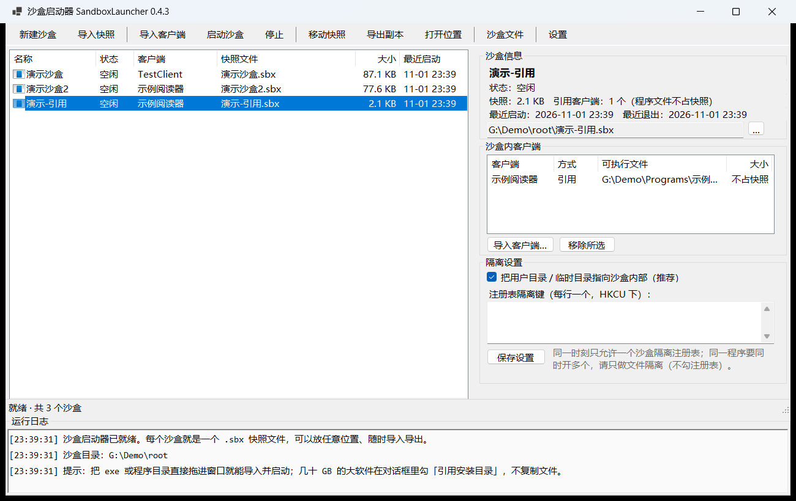

# 沙盒启动器 · SandboxLauncher

把任意 Windows 客户端软件「装进」一个可搬家的沙盒里运行：每个沙盒就是一个 `.sbx` 快照文件，
放在哪儿都行，随时导入导出；软件产生的用户数据、临时文件、指定注册表键都留在沙盒里，
不污染本机。**沙盒里的文件可以直接浏览，也能随时拿回宿主机。**
**几十 GB 的大软件可以「引用安装目录」——不复制程序文件，拖进窗口就能直接启动。**

> 版本 0.4.3 · .NET 9 · Windows 10/11 · MIT



## 下载与运行

到 [Releases](../../releases/latest) 下载 **`SandboxLauncher-0.4.3-win-x64.zip`**，解压到任意目录，
双击里面的 `SandboxLauncher.exe` 就完事：

```
SandboxLauncher-0.4.3-win-x64\
  SandboxLauncher.exe      ← 双击运行（图形界面，全部功能都在这里）
  ...运行时 dll，别删...
  README.md
  LICENSE
```

**免安装、不需要预先安装 .NET**（包内自带运行时）。绿色程序：不写注册表、不留系统服务，
删掉目录就等于卸载；所有沙盒内容都在你自己指定的 `.sbx` 文件里。

想用命令行（`sl`）的话，另有一个可选包 **`SandboxLauncher-cli-0.4.3-win-x64.zip`**，
解压得到 `sl.exe`，同样是自带运行时的免安装单目录版本。两个包互不依赖，都放一起也能用。

> 想再瘦身？从源码 `dotnet publish` 时加 `--self-contained false`，产物体积会降到 1 MB 左右，
> 代价是目标机器要先装 .NET 9 桌面运行时。

---

## 一、它解决了什么

| 需求 | 实现 |
| --- | --- |
| 让客户端软件以沙盒形式启动 | 启动时把快照挂载到独立会话目录，重定向 `USERPROFILE / APPDATA / LOCALAPPDATA / TEMP`，可选切换指定 HKCU 注册表子树，客户端进程只看到沙盒内的世界 |
| 支持新增多个沙盒，每个沙盒都能导入客户端并在沙盒内启动 | 沙盒目录（catalog）可建任意多个；每个沙盒可导入一个或多个客户端（exe 或整个程序目录），直接启动 |
| 沙盒文件是单个快照文件，可配置任意存放位置，支持读取/导入 | 整个沙盒压缩成一个 `.sbx`（ZIP 容器 + manifest + 文件索引），新建时可选任意路径，随时「移动快照 / 导出副本 / 导入快照」，导入后立刻能启动 |
| **浏览沙盒里的文件、把别人发来的文件拿到宿主机** | 「沙盒文件」浏览器：运行中直接看实时目录，没运行就看快照；可打开、导出到宿主机、拖到资源管理器、把宿主文件放进沙盒；还能自动发现程序写到沙盒外的真实目录（例如微信的 `D:\WeChatFiles\xwechat_files`） |
| **同一程序多开：一份程序 + N 个分身，磁盘几乎不涨** | 「VHD 差分盘」：把程序目录搬进一个基础 VHD（不复制，磁盘占用不变），每个分身挂一个差分盘（只存改动块，初始 4 MB）；挂载后是 `<盘符>:\app`，各分身看到自己的数据文件，同一程序可以同时跑多个（实测：两个进程同时独占打开同一个 200 MB 数据文件互不影响） |
| **大程序由用户自己决定要不要虚拟盘** | 导入对话框勾「创建虚拟磁盘（VHDX）」后：自己选**放哪个盘**（下拉显示各盘剩余空间、SSD/HDD）、**挂载盘符**（V–Z 或自动）、**容量**（默认按实测体积 ×1.2）；启动沙盒时自动挂载 |
| **几十 GB 的大软件不用复制就能丢进沙盒** | 「引用安装目录」方式：只记录程序路径、不写快照（3 GB 目录导入 22 毫秒、快照 < 200 KB），启动时直接跑原目录里的程序，只把用户数据重定向进沙盒 |

## 二、快速开始

### 图形界面

双击解压出来的 `SandboxLauncher.exe`（从源码构建时是 `dist\SandboxLauncher\SandboxLauncher.exe`）：

1. **新建沙盒** —— 起个名字，选快照文件存到哪（任意磁盘/目录都行）
2. **导入客户端** —— 选程序目录（连同依赖一起打包）或单个 exe；**也可以直接把 exe / 程序目录拖进窗口**，
   导入完会自动启动
3. **启动沙盒** —— 客户端在沙盒里跑起来；关掉客户端后，改动自动写回 `.sbx`
4. 想搬家：**移动快照** / **导出副本**；换台电脑：**导入快照** 直接接着用
5. 想看/拿沙盒里的文件：点工具栏 **沙盒文件**（或右键沙盒 →「浏览沙盒文件…」）

### 大软件：引用安装目录（v0.3 新增）

几十 GB 的软件（Steam、Office、Adobe、游戏…）复制进快照代价太大。导入对话框里勾上
**「引用安装目录（不复制文件）」**——启动器一个字节的程序文件都不复制，只记下源路径：

- 导入是**秒级**（3 GB 目录 22 毫秒），快照只多几百字节；
- 启动时直接在原安装目录跑，`USERPROFILE / APPDATA / LOCALAPPDATA / TEMP`（可选注册表键）
  照样重定向进沙盒，**用户数据依然隔离、可搬家**；
- 只拖一个 `xxx.exe` 也建议用这个方式：复制单个 exe 会缺 DLL/资源，引用则依赖原目录都在；
- 对话框会按体积自动建议（≥ 2 GB 或只选了一个 exe → 默认勾选引用）。

注意：程序**写进自己安装目录**的文件（部分软件的日志、缓存）不会被隔离，那是原安装目录；
换机器要把源安装目录一起带上，或者改用「复制进快照」。

### 沙盒文件（v0.2 新增）

- **沙盒运行中**：直接浏览解包出来的会话目录（实时），别人刚发来的文件马上能看到；
- **沙盒没运行**：直接浏览 `.sbx` 快照里的内容；
- 选中文件/文件夹后可以：**导出到宿主机**、**打开**（快照里的文件会先解到临时目录再用系统默认程序打开）、
  **拖到资源管理器**、**打开所在目录**、**复制路径**、**删除**；
- **导入文件 / 导入文件夹**：把宿主机的文件放进沙盒的当前目录（运行时直接写会话目录，退出后统一回写快照）；
- 左侧「常用位置」直达用户目录、文档、下载、桌面、Temp、AppData、客户端程序；
- 左侧「宿主目录（沙盒外）」可以手动添加宿主机上的任意文件夹，用来浏览/拷贝程序写在沙盒外的数据。

#### 程序把数据写到沙盒外怎么办？

不少客户端把「文件保存位置」记在自己的配置文件里，写的是**绝对路径**，
所以收到的文件其实落在**沙盒外的真实目录**，比如
`D:\WeChatFiles\xwechat_files\<账号ID>\msg\file\<年-月>\`。

启动器会自动从沙盒内该程序的配置里读出这个位置，在「宿主目录 → xwechat_files」下按账号
列出 **「收到的文件 · 账号ID」** 快捷入口，点开就是别人发来的 PDF / Word / 压缩包：

> 想让这些文件真正留在沙盒里：在该程序「设置 → 文件管理 → 文件默认保存位置」里改成沙盒内路径。
> 沙盒运行时对应的是 `%LOCALAPPDATA%\SandboxLauncher\sessions\<沙盒ID>\fs\profile\Documents`。

### 命令行（`sl.exe`，源码构建时在 `dist\cli\sl.exe`）

```bat
sl list                                            列出沙盒
sl new --name 微信-演示 --snapshot D:\sbx\demo.sbx      新建沙盒（快照放 D 盘）
sl app add --sandbox 微信-演示 --path "D:\Software\Weixin"   导入客户端目录
sl app add --sandbox 大软件 --path "D:\Software\BigApp" --mode reference   不复制程序文件，直接引用安装目录（几十 GB 用这个）
sl app add --sandbox 小工具 --path "D:\Tools\notepad++.exe"               只给一个 exe：默认 auto 也会走引用（依赖留在原目录）
sl run --sandbox 微信-演示                            在沙盒里启动，退出后自动回写快照
sl inspect --sandbox 微信-演示                         查看快照内容
sl export --sandbox 微信-演示 --to D:\backup.sbx        导出副本
sl import --path D:\backup.sbx                        在另一台机器上导入
sl set --sandbox 微信-演示 --isolate-registry "Software\Tencent\WeChat"
sl status                                           查看正在运行的沙盒（含遗留会话）
sl stop --sandbox 微信-演示                            停止并回写快照

rem —— 沙盒文件 ——
sl files info   --sandbox 演示沙盒                         文件来源：实时会话 / 快照
sl files ls     --sandbox 演示沙盒 --path profile/Documents  列出目录
sl files find   --sandbox 演示沙盒 --name "*.pdf"            递归找文件
sl files export --sandbox 演示沙盒 --path profile/Documents --to D:\导出
sl files import --sandbox 演示沙盒 --from D:\资料.pdf --path profile/Documents
sl files open   --sandbox 演示沙盒 --path profile/Documents
sl files rm     --sandbox 演示沙盒 --path profile/Temp       删除沙盒里的文件
sl files host add --sandbox 演示沙盒 --path "D:\WeChatFiles\xwechat_files"
sl files detect --sandbox 演示沙盒                          探测程序写到沙盒外的目录

rem —— 直接操作沙盒外的宿主目录（不经过沙盒也能用） ——
sl files ls     --host "D:\WeChatFiles\xwechat_files\wxid_xxx\msg\file\2023-07"
sl files export --host "D:\WeChatFiles\xwechat_files\wxid_xxx\msg\file\2023-07" --path "资料.pdf" --to D:\导出
```

```bat
rem —— VHD 差分盘（同一程序多开，磁盘几乎不涨）——
sl vhd disks                                                       rem 列出能放 VHD 的盘（剩余空间/SSD 排序）
sl vhd base  --name demo --source "D:\Games\DemoGame" --size-gb 120 --at "G:" --letter V   rem 指定放 G:、挂到 V:
sl vhd import --sandbox 分身A --name demo --source "D:\Games\DemoGame" --at "G:" --size-gb 120 --letter V   rem 一步建盘+挂载+登记
sl vhd child --name 分身A --parent demo      rem 建差分盘（初始 4 MB，写出多少才占多少）
sl vhd mount --name 分身A                   rem 挂载 → 例如 V:（程序在 V:\app）
sl vhd dismount --name 分身A
sl vhd list                                 rem 列出基础盘/差分盘、盘符、实际占用
```

所有命令输出 JSON，方便脚本调用；`sl --help` 看全部命令。
`--mode` 三个取值：`copy`（复制进快照，原行为）、`reference`（引用安装目录，不复制）、
`auto`（默认：只给一个 exe 或目录 ≥ 2 GB → 引用，否则复制）。
图形界面也能直接打开某个沙盒的文件浏览器：
`SandboxLauncher.exe --files "演示沙盒" [--path profile/Documents] [--host D:\WeChatFiles\xwechat_files] [--root <元数据目录>]`。

## 三、沙盒是怎么"隔"的

启动一个沙盒时依次做五件事：

1. **挂载**：把 `.sbx` 解包到会话目录 `%LOCALAPPDATA%\SandboxLauncher\sessions\<id>\fs`
   （引用模式的客户端没有程序文件在快照里，只解出用户数据）
2. **改环境**：子进程的 `USERPROFILE`、`APPDATA`、`LOCALAPPDATA`、`TEMP/TMP`、`HOMEDRIVE/HOMEPATH`
   全部指向会话目录（见 `EnvBuilder`）
3. **切注册表**（可选）：把设置里列的 HKCU 子树（如 `Software\Tencent\WeChat`）先备份宿主状态，
   再换成快照里存的那份，客户端写注册表实际写进沙盒
4. **启动 + 跟踪整棵进程树**：客户端被「挂起创建 → 放进作业对象（Job Object）→ 放行」，
   所以启动器稍后拉起来的子进程也在跟踪范围内。**启动器自己退出了但子进程还在跑时，沙盒不会收尾**，
   会继续等整棵树结束（`ProcessTree`）。"停止沙盒"会把整棵树一起结束，不留孤儿
5. **回写**：整棵树都退出后，增量同步改动进 `.sbx`（没变的文件不重新压缩），还原宿主注册表，删除会话目录

回写是**容错**的：读不到的目录（典型是 `INetCache\Content.IE5`）、被客户端独占的文件、
junction/符号链接、只读文件都不会再让整次回写失败；系统缓存目录默认跳过（可在设置里关掉）。

```
.sbx (单个文件)
├── manifest.json   沙盒名称、客户端清单、隔离设置
├── index.json      文件索引（大小/时间/SHA256），用来做增量回写
├── fs/…            沙盒里的整个世界：profile/（用户目录）、apps/（客户端）
└── registry/…      被隔离的注册表子树快照
```

## 四、已知边界（重要，别踩坑）

1. **不是内核级沙盒，没有驱动**。它靠环境变量 + 注册表切换做隔离，等价于"可搬家的独立用户配置"，
   **不是安全沙盒**——恶意程序仍然能访问真实磁盘。要防病毒/防越权，请用 Windows Sandbox 或虚拟机。
2. **不认环境变量的程序会漏出去**。用 `SHGetKnownFolderPath`（读注册表 Shell 文件夹）的程序，
   仍然会把数据写到真实用户目录。微信 4.x 还会把「文件保存位置」记成绝对路径，收到的文件直接写到
   `D:\WeChatFiles\xwechat_files`。这类数据在「沙盒文件 → 宿主目录」里能看到/打开/拷贝（会自动检测），
   但**不会进快照**，换机器不会跟着走。
3. **同一个微信号不能同时多开；不同账号可以同时跑（微信 4.x 实测）**。
   微信 4.x 的实例锁按「账号身份」区分（二进制里能扒到 `_WeChat_Win_User_Identity_Mutex_Name`），
   所以宿主登录账号 A、沙盒登录账号 B 时两个实例能共存（实测）；
   同一个号再开第二个会被激活/顶掉（客户端锁 + 服务端多设备策略）。
   但要注意：不同账号同机运行时共用同一个「文件保存位置」根目录（是个绝对路径，例如 `D:\WeChatFiles\xwechat_files`），
   数据各自分账号子目录、并不算真正隔离，换机器也不会跟着 `.sbx` 走。
   要彻底隔离/多开，用虚拟机或 Windows Sandbox。本工具的定位是：**每个沙盒一份独立数据，随时搬走**，而不是绕过单例限制。
4. **单实例程序一次只能开一个（网游启动器、办公客户端常见这种情况）**。实例锁是 Windows 会话级的
   mutex，改环境变量碰不到它：第一个沙盒里已经开着启动器时，第二个沙盒再启动会**秒退（退出码 0）**。
   现在会在启动日志/界面弹窗里直接说明原因（「同一个程序已经在运行：沙盒「xxx」（PID …）」）：
   先停掉那个沙盒再启动另一个。想做真双开，需要会话级隔离（Windows Sandbox / 虚拟机 / 不同 Windows 用户）。
5. **注册表隔离是"排队"的**。同一时刻只允许一个沙盒占用注册表隔离（否则会互相打架），
   启动器会直接报错提示。只做文件隔离的沙盒可以同时跑多个。
6. 快照是整包 ZIP，复制方式导入一个 1 GB 客户端就会得到一个 1 GB 快照，启动时还要整包解到会话目录
   （峰值磁盘 ≈ 2 倍体积）。几十 GB 的软件请用「引用安装目录」，它一个字节的程序文件都不复制。
   首次回写较慢，之后走增量。
7. **运行中的沙盒**：文件浏览器直接读写会话目录（改动会先落盘，退出时再写回快照）；
   如果启动器被强杀，会话目录会保留，下次启动会自动回写并清理。遇到刚被杀掉的客户端还捏着句柄时，
   启动器会把删不掉的旧会话目录挪成 `<id>.stale-<时间>` 继续启动，不会再卡住这个沙盒。
8. `.sbx` 里的修改时间按 UTC 保存，文件浏览器显示的是本地时间。
9. 快照里的大目录（例如整个 `profile/AppData`）用「打开所在目录」会先解包到临时目录，
   体积大时会提示；只想拿几个文件请用「导出到宿主机」。
10. **VHD 差分盘**：需要管理员权限 + Windows 自带的 VHD 能力（Hyper-V 的 `New-VHD`/`Mount-VHD`）。
    差分盘只存改动块，但**程序自己打补丁/修复数据时的写入也会落在每个差分盘上**（实测：一次"修补"写了 8 GB+）；
    最好先挂载基础盘让程序完成一次修补，再基于修好的基础盘建差分盘。盘符会变（游戏若记绝对路径需要重设）。
11. **引用模式的程序文件在沙盒外**：只隔离用户数据（和可选的注册表键）。程序写进自己安装目录的内容
    （部分软件的日志、缓存）不会被隔离，也不进快照；源安装目录被移动/重命名/卸载后启动会明确报错
    「源程序不在了」。想把程序也搬走，就用「复制进快照」。

## 五、源码结构

```
src/
  SandboxLauncher.Core/     引擎（无 UI 依赖）
    Model/Models.cs         沙盒/客户端/清单/设置数据模型
    Core/CatalogStore.cs    沙盒目录 catalog.json、全局设置
    Snapshot/SnapshotFile.cs  .sbx 读写：创建/挂载/增量回写/就地修改
    Snapshot/FsWalker.cs    容错目录遍历（无权限目录、junction、缓存）
    Snapshot/PathFilter.cs  快照排除规则
    Files/SandboxFiles.cs   沙盒文件浏览/导出/导入/删除（会话目录、快照、宿主目录）
    Files/ExternalFolderDetector.cs  发现程序写到沙盒外的数据目录
    Runtime/EnvBuilder.cs   进程环境变量重定向
    Runtime/RegistrySandbox.cs  HKCU 子树导出/导入/切换
    Runtime/AppImporter.cs  导入客户端、抽图标、统计/估算体积、自动判断复制 or 引用
    Runtime/ProcessTree.cs  作业对象（Job Object）：整棵进程树跟踪、停止时连子进程一起结束
    Runtime/VhdService.cs   VHD 差分盘：基础盘/差分盘创建、挂载、卸载（块级写时复制）
    Runtime/SandboxService.cs  启动/停止/回写/崩溃恢复/文件作用域（含引用模式启动路径、单实例提示）
  SandboxLauncher.Cli/      命令行 sl.exe（含 sl files …、app add --mode）
  SandboxLauncher.App/      WinForms 界面 SandboxLauncher.exe + SandboxFilesDialog（支持拖拽导入并启动）
tools/TestClient/           模拟客户端（验证隔离与快照用）
tools/capture-window.ps1    开发用：截取指定进程窗口（GUI 验收截图）
tests/SandboxLauncher.Tests/ 端到端测试（103 项，无需测试框架）
```

## 六、构建与测试

```bat
dotnet build src\SandboxLauncher.App\SandboxLauncher.App.csproj -c Release
dotnet build src\SandboxLauncher.Cli\SandboxLauncher.Cli.csproj -c Release
dotnet build tools\TestClient\TestClient.csproj -c Release

dotnet run --project tests\SandboxLauncher.Tests -c Release
```

测试覆盖：新建沙盒 → 导入客户端 → 沙盒内启动 → 文件/注册表隔离 → 退出回写 →
状态跨次延续 → 移动快照 → 导出 → 导入新目录继续用 → 单文件导入 → 移除客户端；
以及 v0.2 的文件浏览/导出/导入、运行中实时读写、只读文件与 junction 回写、
系统缓存跳过、沙盒外目录探测、宿主目录浏览与拷贝；
v0.3 的引用模式（3 GB 目录不复制、秒级导入、原目录启动、源目录消失报错、只给 exe 也能跑、auto 建议），
以及 v0.3.1 的启动器/子进程形态：启动器自己退出后沙盒继续等子进程、停止时连整棵树一起结束、
「同一个程序已经在运行」的提示与秒退解释。

## 七、路线图

- [x] 沙盒文件浏览器：浏览 / 导出到宿主机 / 导入 / 拖出 / 打开目录
- [x] 沙盒外数据目录自动探测（微信 `xwechat_files` 等）
- [x] 回写容错：无权限目录、只读文件、junction、系统缓存跳过
- [x] 引用安装目录模式：几十 GB 大软件不复制，拖进窗口直接启动
- [x] VHD 差分盘：一份程序 + N 个分身，块级写时复制（磁盘几乎不涨）
- [x] 进程树跟踪（Job Object）：启动器先退、子进程还在跑时继续等；停止时连子进程一起结束
- [x] 单实例提示：同一个程序已经在别的沙盒/宿主上运行时，启动日志与弹窗直接说明原因
- [ ] 文件搜索改成后台索引（大快照里按文件名秒搜）
- [ ] 监视「收到的文件」目录并自动提醒（托盘）
- [ ] 应用兼容性配置：Electron 程序自动加 `--user-data-dir`、常见客户端内置隔离模板
- [ ] 注册表隔离并发（按键加锁，而不是整机排队）
- [ ] Windows Sandbox 后端：在支持 Hyper-V 的机器上生成 `.wsb`，实现真正的会话级隔离
- [ ] 快照压缩率/分卷：大客户端首次导入更快、支持拆分
- [ ] 托盘常驻 + 沙盒运行中退出启动器时后台托管

---

**目录约定**：启动器元数据在 `%LOCALAPPDATA%\SandboxLauncher`（catalog.json / settings.json / logs / sessions），
沙盒内容**只**在 `.sbx` 文件里，所以换机器只要带走 `.sbx`。

## 八、参与开发

```bat
git clone <本仓库地址>
cd sandbox-launcher
dotnet build SandboxLauncher.sln -c Release
dotnet build tools\TestClient\TestClient.csproj -c Release
dotnet run --project tests\SandboxLauncher.Tests -c Release
```

端到端测试会自己建临时目录、自己清理，不碰你本机已有的沙盒；VHD 相关用例在没有
Hyper-V/VHD 能力的机器上会自动跳过。跑完应看到 `通过 103 项，失败 0 项`。

欢迎提 Issue 讲清楚「什么程序、什么症状、期望是什么」；涉及具体客户端的兼容性问题，
最好附上 `%LOCALAPPDATA%\SandboxLauncher\logs\` 里对应的日志（**贴之前请自己检查一遍有没有
账号、文件名之类的隐私内容**）。

## 九、许可

[MIT](LICENSE)。这是个 clean-room 自研项目，没有使用 Sandboxie 等现有沙盒产品的代码。
`Sandboxie`、`Windows Sandbox`、各被提及的软件名称均为其各自所有者的商标，
本项目与之没有隶属或背书关系。

**安全声明**：本工具做的是「用户数据/注册表重定向」，用于隔离配置、便携搬家和多份数据共存；
它**不是**安全沙盒，不能防病毒、不能阻止程序访问真实磁盘。需要安全隔离请用 Windows Sandbox、沙盒虚拟机
或其他带驱动的方案。

